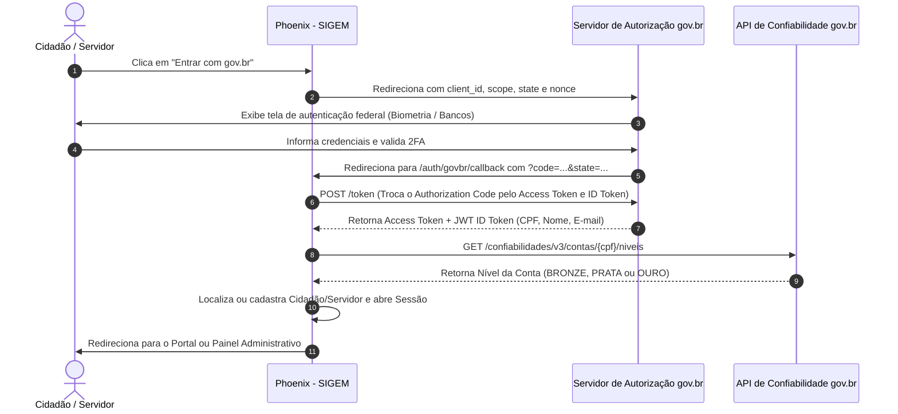

# GUIA TÉCNICO DE INTEGRAÇÃO — LOGIN ÚNICO GOV.BR

> **Phoenix - SIGEM (Sistema Integrado de Gestão Municipal)**  
> **Fundamentação Legal:** Lei Federal nº 14.129/2021 (Governo Digital), Lei nº 14.063/2020 (Assinatura Eletrônica) e Portaria SEDGG/ME nº 2.154/2021.

---

## 1. Visão Geral

A integração com o **Login Único gov.br** permite que o município elimine a necessidade de criar e gerenciar senhas locais para os munícipes, oferecendo:

1. **Acesso Simplificado:** O cidadão utiliza o mesmo CPF e senha que já utiliza na Receita Federal, Meu INSS e Carteira Digital de Trânsito.
2. **Assinatura Eletrônica Avançada sem Custo:** Servidores e cidadãos com conta nível **Prata** ou **Ouro** podem assinar digitalmente requerimentos, atestados e certidões com validade jurídica garantida pela Lei 14.063/2020.
3. **Conformidade Total com a LGPD:** O gov.br valida a identidade do titular sem expor dados desnecessários.

---

## 2. Passo a Passo para Adesão Oficial da Prefeitura

### Passo 1: Solicitação de Adesão Institucional
1. O Prefeito Municipal ou Procurador-Geral deve acessar o [Portal de Serviços do Governo Federal - MGI](https://www.gov.br/governodigital/pt-br/identidade/solicitar-integracao).
2. Preencher o **Termo de Adesão ao Login Único (gov.br)** com o CNPJ da Prefeitura Municipal e os dados do Gestor de TI indicado.
3. Indicar que a integração será do tipo **Órgão Municipal / Estadual (Subnacional)**.

### Passo 2: Credenciamento do Ambiente de Homologação (Staging)
Após a homologação do pedido, a Secretaria de Governo Digital (SGD) fornecerá:
- `client_id` (ex: `prefeitura-sigem-staging`)
- `client_secret` (chave criptográfica fornecida pela SGD)
- Cadastro da URL de Redirecionamento (Redirect URI):  
  `https://sigem.prefeitura.gov.br/auth/govbr/callback`

### Passo 3: Ativação no Phoenix - SIGEM
No arquivo `.env` do servidor de produção:

```ini
# Configuração do Login Único Federal gov.br
GOVBR_ENABLED=true
GOVBR_ENVIRONMENT=production
GOVBR_CLIENT_ID="seu_client_id_fornecido_pelo_mgi"
GOVBR_CLIENT_SECRET="sua_chave_secreta_fornecida_pelo_mgi"
GOVBR_REDIRECT_URI="https://sigem.prefeitura.gov.br/auth/govbr/callback"
```

---

## 3. Fluxo de Autenticação OAuth2 / OpenID Connect



---

## 4. Níveis de Confiabilidade e Permissões de Assinatura

| Nível gov.br | Critério de Validação | Tipo de Assinatura Permitida (Lei 14.063/2020) | Uso no Phoenix - SIGEM |
|:---:|---|:---:|---|
| **BRONZE** | Validação em bases da Previdência Social ou Receita Federal (básica) | **Simples** | Abertura de chamados de zeladoria, agendamento de consultas, pedidos de certidão |
| **PRATA** | Reconhecimento facial no app gov.br ou validação por Internet Banking de 14 bancos conveniados | **Avançada** | Despachos administrativos de servidores, requerimentos tributários, recursos de multas |
| **OURO** | Reconhecimento facial cruzado com a base biométrica do TSE ou Certificado Digital ICP-Brasil | **Avançada e Qualificada** | Decretos, portarias, termos de contratos administrativos e pareceres da Procuradoria |

---

## 5. Endpoints de Referência

- **Autorização (Staging):** `https://sso.staging.acesso.gov.br/authorize`
- **Token (Staging):** `https://sso.staging.acesso.gov.br/token`
- **UserInfo (Staging):** `https://sso.staging.acesso.gov.br/userinfo`
- **Autorização (Produção):** `https://sso.acesso.gov.br/authorize`
- **Token (Produção):** `https://sso.acesso.gov.br/token`
- **UserInfo (Produção):** `https://sso.acesso.gov.br/userinfo`

---

## 6. Segurança e Armazenamento dos Tokens

1. O `access_token` e `id_token` do gov.br **não** devem ser expostos em cookies do navegador ou `localStorage`.
2. A sessão no Phoenix - SIGEM é criada utilizando os cookies de sessão protegidos (`HttpOnly`, `SameSite=Lax`, `Secure`).
3. O CPF retornado no `id_token` é utilizado para vincular automaticamente o cidadão ao seu cadastro na tabela `clientes` do sistema.
