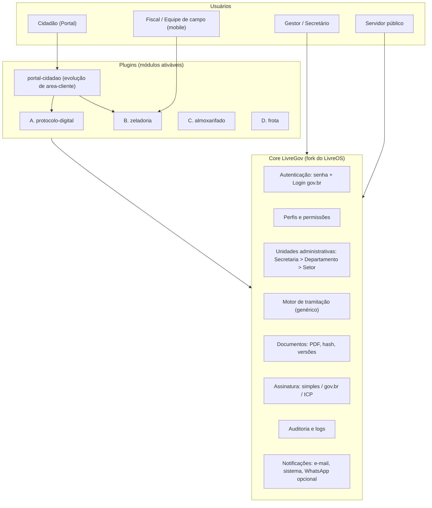
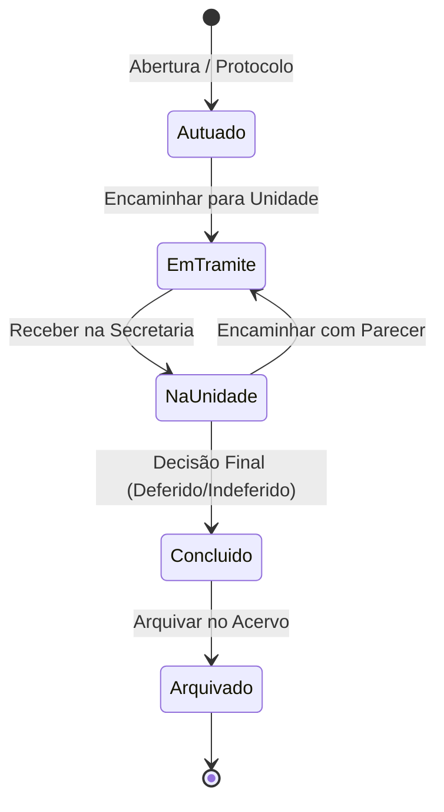
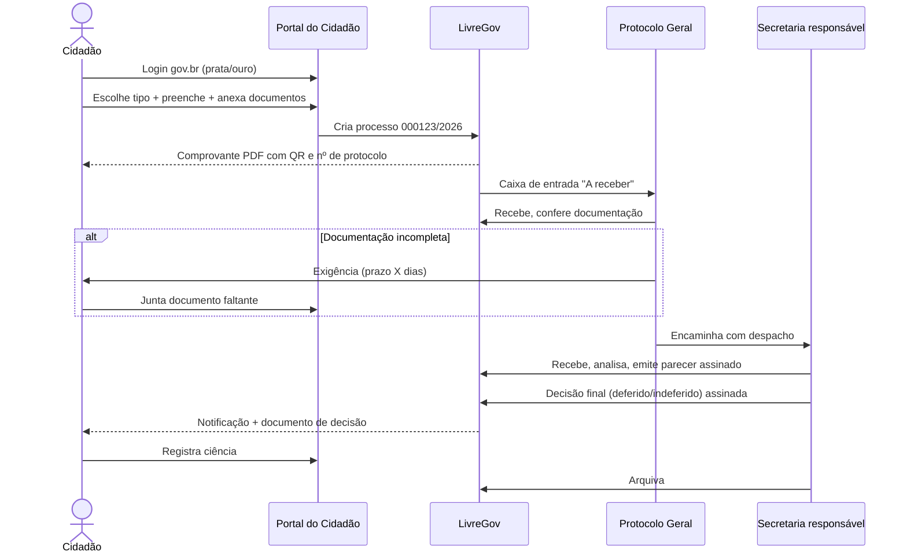
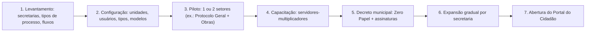

# Plano de Conversão — LivreOS ➜ Phoenix - SIGEM (Sistema Integrado de Gestão Municipal)

> **Nome Oficial Definido:** **Phoenix - SIGEM** (*Sistema Integrado de Gestão Municipal*).
> **Base Tecnológica:** LivreOS (Laravel 12, PHP 8.2+, licença AGPL-3.0).
> **Objetivo:** Transformar o ERP em um **sistema auxiliar setorial para prefeituras**, com foco em **Zero Papel (Protocolo e Tramitação Digital)**, Zeladoria Urbana, Almoxarifado Setorial e Frotas, sem substituir o sistema contábil/orçamentário oficial (SIAFIC).
> **Status Geral do Projeto:** 🛠️ **Fase de Protótipo Funcional Avançado & Endurecimento (Revisão Técnica 24/10/2026).** Módulos principais implementados e em processo de correção de integridade, autorizações por unidade, máquina de estados e saneamento de dados para homologação real.

---

## 0. Status de Execução e Entregas Realizadas

| Fase | Entregável / Funcionalidade | Status | Arquivos / Implementação |
|---|---|:---:|---|
| **Fase 0** | **Ambiente e Execução Local** | ✅ **Concluído** | PHP 8.2 portátil instalado; `php.ini` com extensões habilitadas (`sqlite3`, `curl`, `fileinfo`, `gd`, `zip`, etc.); Servidor ativo em `http://127.0.0.1:8000`; Script de inicialização em 1 clique: [`iniciar-livreos.bat`](file:///c:/Users/Felipe/Desktop/LivreOS-main/iniciar-livreos.bat). |
| **Fase 0** | **Rebranding Oficial (Phoenix - SIGEM)** | ✅ **Concluído** | Logotipo e Favicon institucionais vinculados ([`phoenix_logo.png`](file:///c:/Users/Felipe/Desktop/LivreOS-main/LivreOS/public_html/logo/phoenix_logo.png), [`icone.png`](file:///c:/Users/Felipe/Desktop/LivreOS-main/LivreOS/public_html/logo/icone.png)); Atualização de `.env` (`APP_NAME="Phoenix - SIGEM"`, `APP_TAGLINE="Sistema Integrado de Gestão Municipal"`), `config/app.php`, tela de login e cabeçalhos. |
| **Fase 1.2** | **Ocultação de Módulos Comerciais** | ✅ **Concluído** | Arquivo de controle modular [`config/modulos.php`](file:///c:/Users/Felipe/Desktop/LivreOS-main/LivreOS/sistema_livreos/config/modulos.php) (`vendas=false`, `financeiro=false`, `garantias=false`); Ocultação cirúrgica no menu ([`MenuHelper.php`](file:///c:/Users/Felipe/Desktop/LivreOS-main/LivreOS/sistema_livreos/app/Helpers/MenuHelper.php)) e no Dashboard principal ([`dashboard/index.blade.php`](file:///c:/Users/Felipe/Desktop/LivreOS-main/LivreOS/sistema_livreos/resources/views/pages/dashboard/index.blade.php)). |
| **Fase 1.1** | **Adequação de Terminologia Municipal** | ✅ **Concluído** | Dicionário em [`config/termos.php`](file:///c:/Users/Felipe/Desktop/LivreOS-main/LivreOS/sistema_livreos/config/termos.php) e helper global `termo()`; Adequação para **Cidadão / Contribuinte** (menu, listagem, cadastro e edição de clientes); **Materiais / Almoxarifado**; **Serviços Públicos**; e **Zeladoria / OS**. |
| **Fase 1.3** | **Secretarias e Departamentos (Estrutura)** | ✅ **Unificado** | Criação do [`UnidadeAdministrativaController.php`](file:///c:/Users/Felipe/Desktop/LivreOS-main/LivreOS/sistema_livreos/app/Http/Controllers/UnidadeAdministrativaController.php), views Blade dedicadas em `resources/views/secretarias/` e rotas `/secretarias` unificadas em `unidades_administrativas`, alinhando Protocolo, Zeladoria, Almoxarifado e Frota na mesma estrutura organizacional; Carga inicial via [`MunicipalSeeder.php`](file:///c:/Users/Felipe/Desktop/LivreOS-main/LivreOS/sistema_livreos/database/seeders/MunicipalSeeder.php). |
| **Fase 2** | **Banco de Dados do Protocolo (Zero Papel)** | ✅ **Concluído** | Migration [`2026_05_01_000001_create_protocolo_tramitacao_digital_tables.php`](file:///c:/Users/Felipe/Desktop/LivreOS-main/LivreOS/sistema_livreos/database/migrations/2026_05_01_000001_create_protocolo_tramitacao_digital_tables.php) com tabelas: `unidades_administrativas`, `processos`, `processo_documentos` e `tramitacoes`. |
| **Fase 2** | **Modelos Eloquent & Máquina de Estados** | ✅ **Concluído** | [`Processo.php`](file:///c:/Users/Felipe/Desktop/LivreOS-main/LivreOS/sistema_livreos/app/Models/Processo.php) com gerador automático de protocolo anual sequencial (`2026/000001`), métodos `tramitarPara()`, `receberNaUnidade()` e `concluir()`; Models [`UnidadeAdministrativa.php`](file:///c:/Users/Felipe/Desktop/LivreOS-main/LivreOS/sistema_livreos/app/Models/UnidadeAdministrativa.php), [`ProcessoDocumento.php`](file:///c:/Users/Felipe/Desktop/LivreOS-main/LivreOS/sistema_livreos/app/Models/ProcessoDocumento.php) e [`Tramitacao.php`](file:///c:/Users/Felipe/Desktop/LivreOS-main/LivreOS/sistema_livreos/app/Models/Tramitacao.php). |
| **Fase 2** | **Rotas & Controller de Protocolo** | ✅ **Concluído** | Controlador [`ProtocoloController.php`](file:///c:/Users/Felipe/Desktop/LivreOS-main/LivreOS/sistema_livreos/app/Http/Controllers/ProtocoloController.php) e rotas em [`routes/web.php`](file:///c:/Users/Felipe/Desktop/LivreOS-main/LivreOS/sistema_livreos/routes/web.php) para autuação, listagem, visualização, tramitação, recebimento, conclusão, anexação de documentos com Hash SHA-256 e download seguro. |
| **Fase 2** | **Interface Completa (Telas do Usuário)** | ✅ **Concluído** | Telas Blade desenvolvidas: [`protocolo/index.blade.php`](file:///c:/Users/Felipe/Desktop/LivreOS-main/LivreOS/sistema_livreos/resources/views/protocolo/index.blade.php) (painel com estatísticas e filtros), [`protocolo/create.blade.php`](file:///c:/Users/Felipe/Desktop/LivreOS-main/LivreOS/sistema_livreos/resources/views/protocolo/create.blade.php) (autuação digital de processos) e [`protocolo/show.blade.php`](file:///c:/Users/Felipe/Desktop/LivreOS-main/LivreOS/sistema_livreos/resources/views/protocolo/show.blade.php) (timeline visual de despachos, localização e modais interativos). |
| **Fase 2** | **Testes Automatizados de Fluxo** | ✅ **Concluído** | Testes end-to-end executados via script automatizado com 100% de sucesso (autuação do processo `2026/000001`, tramitação com despacho para a SEFAZ e recebimento). |
| **Fase 3** | **Módulo B: Zeladoria Urbana & Serviços Públicos** | ✅ **Concluído** | Migration [`2026_05_02_000001_create_zeladoria_urbana_tables.php`](file:///c:/Users/Felipe/Desktop/LivreOS-main/LivreOS/sistema_livreos/database/migrations/2026_05_02_000001_create_zeladoria_urbana_tables.php); Model [`CategoriaZeladoria.php`](file:///c:/Users/Felipe/Desktop/LivreOS-main/LivreOS/sistema_livreos/app/Models/CategoriaZeladoria.php) e evolução de [`OrdemServico.php`](file:///c:/Users/Felipe/Desktop/LivreOS-main/LivreOS/sistema_livreos/app/Models/OrdemServico.php) com logradouro, coordenadas e fotos Antes/Depois; Seeder [`ZeladoriaSeeder.php`](file:///c:/Users/Felipe/Desktop/LivreOS-main/LivreOS/sistema_livreos/database/seeders/ZeladoriaSeeder.php) (7 categorias e 8 status municipais); Controlador [`ZeladoriaController.php`](file:///c:/Users/Felipe/Desktop/LivreOS-main/LivreOS/sistema_livreos/app/Http/Controllers/ZeladoriaController.php); Telas Blade [`zeladoria/index.blade.php`](file:///c:/Users/Felipe/Desktop/LivreOS-main/LivreOS/sistema_livreos/resources/views/zeladoria/index.blade.php) (painel e mapa Leaflet/OpenStreetMap), [`zeladoria/create.blade.php`](file:///c:/Users/Felipe/Desktop/LivreOS-main/LivreOS/sistema_livreos/resources/views/zeladoria/create.blade.php) (abertura com mapa picker) e [`zeladoria/show.blade.php`](file:///c:/Users/Felipe/Desktop/LivreOS-main/LivreOS/sistema_livreos/resources/views/zeladoria/show.blade.php) (comparativo de fotos Antes vs Depois, mapa e atesto de serviço); Vínculo com Protocolo Digital; Testes end-to-end homologados (Demanda `ZEL-2026/00111`). |
| **Fase 4** | **Módulo C: Almoxarifado Setorial e Requisições** | ✅ **Concluído** | Migration [`2026_05_03_000001_create_almoxarifado_requisicoes_tables.php`](file:///c:/Users/Felipe/Desktop/LivreOS-main/LivreOS/sistema_livreos/database/migrations/2026_05_03_000001_create_almoxarifado_requisicoes_tables.php) com tabelas `requisicoes_materiais`, `requisicao_material_itens`, `movimentacoes_estoque` (Kardex) e expansão de `depositos`; Models [`RequisicaoMaterial.php`](file:///c:/Users/Felipe/Desktop/LivreOS-main/LivreOS/sistema_livreos/app/Models/RequisicaoMaterial.php), [`RequisicaoMaterialItem.php`](file:///c:/Users/Felipe/Desktop/LivreOS-main/LivreOS/sistema_livreos/app/Models/RequisicaoMaterialItem.php), [`MovimentacaoEstoque.php`](file:///c:/Users/Felipe/Desktop/LivreOS-main/LivreOS/sistema_livreos/app/Models/MovimentacaoEstoque.php); Seeder [`AlmoxarifadoSeeder.php`](file:///c:/Users/Felipe/Desktop/LivreOS-main/LivreOS/sistema_livreos/database/seeders/AlmoxarifadoSeeder.php); Controlador [`AlmoxarifadoController.php`](file:///c:/Users/Felipe/Desktop/LivreOS-main/LivreOS/sistema_livreos/app/Http/Controllers/AlmoxarifadoController.php); Telas Blade [`almoxarifado/requisicoes/index.blade.php`](file:///c:/Users/Felipe/Desktop/LivreOS-main/LivreOS/sistema_livreos/resources/views/almoxarifado/requisicoes/index.blade.php), [`create.blade.php`](file:///c:/Users/Felipe/Desktop/LivreOS-main/LivreOS/sistema_livreos/resources/views/almoxarifado/requisicoes/create.blade.php), [`show.blade.php`](file:///c:/Users/Felipe/Desktop/LivreOS-main/LivreOS/sistema_livreos/resources/views/almoxarifado/requisicoes/show.blade.php) e [`almoxarifado/movimentacoes/index.blade.php`](file:///c:/Users/Felipe/Desktop/LivreOS-main/LivreOS/sistema_livreos/resources/views/almoxarifado/movimentacoes/index.blade.php); Fluxo completo homologado (Solicitação ➜ Aprovação Chefia ➜ Baixa Automática no Almoxarifado ➜ Confirmação de Recebimento). |
| **Fase 5** | **Módulo D: Frota e Garagem Municipal** | ✅ **Concluído** | Migration [`2026_05_04_000001_create_frota_municipal_tables.php`](file:///c:/Users/Felipe/Desktop/LivreOS-main/LivreOS/sistema_livreos/database/migrations/2026_05_04_000001_create_frota_municipal_tables.php); Models [`Veiculo.php`](file:///c:/Users/Felipe/Desktop/LivreOS-main/LivreOS/sistema_livreos/app/Models/Veiculo.php), [`Motorista.php`](file:///c:/Users/Felipe/Desktop/LivreOS-main/LivreOS/sistema_livreos/app/Models/Motorista.php), [`Viagem.php`](file:///c:/Users/Felipe/Desktop/LivreOS-main/LivreOS/sistema_livreos/app/Models/Viagem.php), [`Abastecimento.php`](file:///c:/Users/Felipe/Desktop/LivreOS-main/LivreOS/sistema_livreos/app/Models/Abastecimento.php); Seeder [`FrotaSeeder.php`](file:///c:/Users/Felipe/Desktop/LivreOS-main/LivreOS/sistema_livreos/database/seeders/FrotaSeeder.php); Controlador [`FrotaController.php`](file:///c:/Users/Felipe/Desktop/LivreOS-main/LivreOS/sistema_livreos/app/Http/Controllers/FrotaController.php); Telas Blade em [`resources/views/frota/`](file:///c:/Users/Felipe/Desktop/LivreOS-main/LivreOS/sistema_livreos/resources/views/frota/); Ciclo do Diário de Bordo (Saída ➜ Retorno com km rodado ➜ Abastecimento com cálculo de km/l) testado e homologado de ponta a ponta. |
| **Fase 6** | **Portal do Cidadão & Transparência Pública** | ✅ **Concluído** | Layout público exclusivo ([`layouts/portal.blade.php`](file:///c:/Users/Felipe/Desktop/LivreOS-main/LivreOS/sistema_livreos/resources/views/layouts/portal.blade.php)); Página Inicial do Portal (`/portal`, `/cidadao`); Consulta pública de processos com linha do tempo e mascaramento LGPD (`/portal/processos`); Ouvidoria e solicitação de serviços urbanos com foto e geolocalização (`/portal/zeladoria/nova`); Acompanhamento de demanda em tempo real (`/portal/zeladoria/{codigo}`) com esteira de progresso; Verificador criptográfico de autenticidade documental por Hash SHA-256 (`/portal/autenticidade`). |
| **Fase 7** | **Segurança, LGPD & Integrações Avançadas** | ✅ **Concluído** | Minuta Oficial de Decreto Municipal do Programa Zero Papel ([`DECRETO-MUNICIPAL-ZERO-PAPEL.md`](file:///c:/Users/Felipe/Desktop/LivreOS-main/DECRETO-MUNICIPAL-ZERO-PAPEL.md)); Arquitetura e Guia Técnico de Integração com o Login Único gov.br ([`GOVBR-INTEGRACAO.md`](file:///c:/Users/Felipe/Desktop/LivreOS-main/GOVBR-INTEGRACAO.md), [`config/govbr.php`](file:///c:/Users/Felipe/Desktop/LivreOS-main/LivreOS/sistema_livreos/config/govbr.php), [`GovBrAuthController.php`](file:///c:/Users/Felipe/Desktop/LivreOS-main/LivreOS/sistema_livreos/app/Http/Controllers/GovBrAuthController.php)); Trilha de Auditoria LAI/LGPD para processos sigilosos/restritos ([`AuditProcessoSigiloso.php`](file:///c:/Users/Felipe/Desktop/LivreOS-main/LivreOS/sistema_livreos/app/Models/AuditProcessoSigiloso.php), painel `/admin/audit-processos-sigilosos`); Hardening de rotas herdadas do template sob autenticação. |
| **Transversal** | **Rework do Dashboard (Centro de Comando Municipal)** | ✅ **Concluído** | Reestruturação completa de [`DashboardController.php`](file:///c:/Users/Felipe/Desktop/LivreOS-main/LivreOS/sistema_livreos/app/Http/Controllers/DashboardController.php) e [`dashboard/index.blade.php`](file:///c:/Users/Felipe/Desktop/LivreOS-main/LivreOS/sistema_livreos/resources/views/pages/dashboard/index.blade.php) abandonando visão comercial/loja e implantando o **Centro de Comando Operacional (CCO)**: 4 cards de KPIs estratégicos (Zero Papel, Zeladoria, Almoxarifado, Cidadãos/Secretarias); Mapa Operacional em tempo real com **Leaflet.js & OpenStreetMap**; Gráfico de carga e gargalos por Secretaria; Feed de tramitações eletrônicas recentes; Fila de decisão e processos prioritários com ações rápidas de 1 clique. |
| **Transversal** | **Suporte Completo ao Tema Escuro (Dark Mode)** | ✅ **Concluído** | Correção integral de classes Tailwind no Dashboard ([`dashboard/index.blade.php`](file:///c:/Users/Felipe/Desktop/LivreOS-main/LivreOS/sistema_livreos/resources/views/pages/dashboard/index.blade.php)); Substituição de classes órfãs (`gray-850`, `gray-750`) por classes do tema (`dark:bg-gray-800`, `dark:border-gray-700`, `dark:bg-gray-700`, `dark:bg-gray-900`); Estilização Scoped do Leaflet para Dark Mode (filtro invertido/saturado estilo centro de comando tático militar, popups dark e controles escuros). |
| **Transversal** | **Busca Global Municipal (Omnisearch) com Hierarquia de Permissões** | ✅ **Concluído** | Transformação do antigo "Buscar OS" em uma **Ferramenta Central de Busca Municipal**: Controlador [`BuscaGlobalController.php`](file:///c:/Users/Felipe/Desktop/LivreOS-main/LivreOS/sistema_livreos/app/Http/Controllers/BuscaGlobalController.php) com rotas `/busca` e `/api/busca-global`; Pesquisa unificada em Processos (Zero Papel), Zeladoria Urbana, Almoxarifado/Materiais, Cidadãos e Secretarias; **Controle Estrito de Permissões**: Administradores/Gabinete têm visão total; Servidores acessam conforme seus papéis; Cidadãos do portal só acessam seus próprios processos e solicitações (bloqueio de suprimentos e dados de terceiros); Componente de busca no cabeçalho ([`app-header.blade.php`](file:///c:/Users/Felipe/Desktop/LivreOS-main/LivreOS/sistema_livreos/resources/views/layouts/app-header.blade.php)) com Live Search instantâneo (dropdown dinâmico), atalho `Ctrl+K` e painel completo com abas interativas ([`pages/busca/index.blade.php`](file:///c:/Users/Felipe/Desktop/LivreOS-main/LivreOS/sistema_livreos/resources/views/pages/busca/index.blade.php)). |

---

## Sumário

0. [Status de Execução e Entregas Realizadas](#0-status-de-execução-e-entregas-realizadas)
1. [Escopo](#1-escopo)
2. [Premissas e decisões importantes](#2-premissas-e-decisões-importantes)
3. [Arquitetura alvo](#3-arquitetura-alvo)
4. [Fase 0 — Fundação do projeto](#4-fase-0--fundação-do-projeto)
5. [Fase 1 — Adaptações transversais](#5-fase-1--adaptações-transversais)
6. [Fase 2 — Módulo A: Protocolo Digital e Tramitação (Zero Papel)](#6-fase-2--módulo-a-protocolo-digital-e-tramitação-zero-papel)
7. [Fase 3 — Módulo B: Zeladoria Urbana e Serviços Públicos](#7-fase-3--módulo-b-zeladoria-urbana-e-serviços-públicos)
8. [Fase 4 — Módulo C: Almoxarifado Setorial e Requisições](#8-fase-4--módulo-c-almoxarifado-setorial-e-requisições-de-materiais)
9. [Fase 5 — Módulo D: Frota e Garagem Municipal](#9-fase-5--módulo-d-frota-e-garagem-municipal)
10. [Fase 6 — Portal do Cidadão & Transparência Pública](#10-fase-6--portal-do-cidadão--transparência-pública)
11. [Fase 7 — Segurança, LGPD & Integrações Avançadas](#11-fase-7--segurança-lgpd--integrações-avançadas)
12. [Conformidade legal e normativa](#12-conformidade-legal-e-normativa)
13. [Infraestrutura, segurança e implantação](#13-infraestrutura-segurança-e-implantação)
14. [Cronograma e Status Final de Entrega](#14-cronograma-e-status-final-de-entrega)
15. [Riscos e mitigação](#15-riscos-e-mitigação)
16. [Histórico Completo de Entregas Realizadas](#16-histórico-completo-de-entregas-realizadas)
17. [Anexos (Arquivos-chave e Minuta de Decreto)](#anexo-a--arquivos-chave-do-livreos-e-phoenix---sigem)

---

## 1. Escopo

### 1.1 O que o sistema **será**

Uma plataforma auxiliar, modular, para setores da prefeitura que hoje trabalham com papel, planilhas ou WhatsApp:

| # | Módulo | Público principal |
|---|--------|-------------------|
| A | **Protocolo Digital e Tramitação (Zero Papel)** | Protocolo geral, todas as secretarias, cidadão |
| B | **Zeladoria Urbana e Serviços Públicos** | Obras, Serviços Urbanos, Iluminação, Meio Ambiente |
| C | **Almoxarifado Setorial** | Almoxarifado central e das secretarias |
| D | **Frota e Manutenção de Veículos** | Setor de transportes / garagem municipal |

### 1.2 O que o sistema **não será** (fora de escopo)

- Contabilidade pública, orçamento e execução da despesa (SIAFIC / Lei 4.320/64).
- Folha de pagamento e RH oficial.
- Tributação (IPTU, ISS, dívida ativa).
- Licitações e contratos (Lei 14.133/2021). Pode haver integração futura, mas não faz parte deste plano.
- Prestação de contas a Tribunal de Contas (SIM, AUDESP, SAGRES etc.).

> [!IMPORTANT]
> Os módulos **financeiros** do LivreOS (contas a pagar/receber, PDV, vendas, propostas comerciais, comissões) **serão desativados**. Os valores registrados no LivreGov (ex.: custo de manutenção de veículo) servem **apenas para controle gerencial**. Eles não substituem o empenho/liquidação feitos no sistema contábil oficial.

---

## 2. Premissas e decisões importantes

### 2.1 Licença (AGPL-3.0)

- O LivreOS é AGPL-3.0. O derivado (LivreGov) **também precisa ser AGPL-3.0**.
- Se o sistema for disponibilizado via rede (web), o **código-fonte modificado deve ficar acessível** aos usuários. Para o setor público isso é uma vantagem: é compatível com o modelo de **Software Público Brasileiro**.
- **Manter os cabeçalhos de copyright originais** (`@author viniciusvams`) e adicionar os novos autores.

### 2.2 Estratégia de código: *fork* + plugins

| Opção | Prós | Contras | Decisão |
|-------|------|---------|---------|
| Só plugins (sem mexer no core) | Fácil atualizar a partir do LivreOS original | A terminologia está fixa nas views Blade, então só plugins não resolvem | ❌ |
| Fork total, sem plugins | Liberdade total | Perde a modularidade, e os módulos ficam acoplados | ❌ |
| **Fork leve do core + 1 plugin por módulo** | O core recebe as adaptações transversais e cada módulo é ativado/desativado por prefeitura | Exige disciplina para não espalhar código | ✅ **Adotada** |

O sistema de plugins já existe (`plugins/<slug>/plugin.php`). Ele usa hooks no estilo WordPress (`add_filter('menu.items', ...)`, `erp_register_activation_hook`, etc.), como mostra [exemplo-plugin/plugin.php](LivreOS/sistema_livreos/plugins/exemplo-plugin/plugin.php).

### 2.3 Reaproveitar vs. criar novo

| Necessidade | Reaproveita do LivreOS | Cria novo |
|---|---|---|
| Usuários, perfis, permissões | `User`, `Role`, `Permission` | Vínculo usuário ↔ unidade administrativa |
| Cidadão/requerente | `Cliente`, `Contato`, `Endereco` | Campos específicos (CPF obrigatório, NIS opcional) |
| Processo administrativo | Padrões de `OrdemServico` (log, anexos, assinatura, PDF) | **Entidade nova `Processo`**: a OS tem campos de produtos/valores que não se aplicam |
| Ordem de serviço de zeladoria | **`OrdemServico` direto** (encaixe natural) | Geolocalização, fotos antes/depois, origem da demanda |
| Almoxarifado | `Produto`, `Deposito`, estoque, `CentroCusto` | Requisição de material com aprovação |
| Frota | `Equipamento`, `EquipamentoPublicoAcesso` (QR) | Abastecimento, quilometragem, motoristas |
| Assinatura | `OrdemServicoAssinatura*`, `UserSignature` | Assinatura genérica de documentos de processo |
| Auditoria | `AuditLoginAcesso`, `AuditCancelExcluir` | Auditoria de acesso a processo sigiloso |
| Modelos de documento | `PropostaDocumentoModelo` (Word/HTML) | Modelos de despacho, ofício, certidão |

### 2.4 Assinatura eletrônica: nível jurídico real

A Lei 14.063/2020 define três níveis de assinatura eletrônica:

| Nível | O que é | LivreOS hoje | Uso recomendado |
|-------|---------|--------------|-----------------|
| **Simples** | Identifica o signatário (login, aceite, IP, data/hora) | ✅ **Já existe** (token, IP, base legal, evento) | Despachos internos, ciência, atos de baixo risco |
| **Avançada** | Vinculada ao signatário de forma unívoca (ex.: **assinatura gov.br**) | ❌ Precisa de integração | Maioria dos atos com o cidadão e entre secretarias |
| **Qualificada** | Certificado digital **ICP-Brasil** | ❌ Precisa de integração | Atos que a lei exige (ex.: transferência de imóveis), decisões de maior impacto |

> [!WARNING]
> **Correção de uma afirmação anterior:** o módulo de assinatura do LivreOS atende hoje **apenas ao nível simples**. Para atos administrativos com plena validade jurídica, o plano prevê integrar a **API de Assinatura gov.br** (avançada) e, opcionalmente, certificados **ICP-Brasil** (qualificada). Cada município deve definir por **decreto** quais atos aceitam qual nível (art. 5º da Lei 14.063/2020).

---

## 3. Arquitetura alvo



### 3.1 Componentes transversais novos no core

1. **Unidades Administrativas** (hierárquicas), que substituem o uso de `CentroCusto` como "secretaria".
2. **Motor de Tramitação genérico**: usado pelo Protocolo (A) e reaproveitável por Zeladoria (B) e Almoxarifado (C).
3. **Serviço de Documentos**: armazenamento com hash SHA-256, versionamento e carimbo de assinatura.
4. **Serviço de Assinatura** desacoplado de OS (`AssinaturaService` com *drivers*: `simples`, `govbr`, `icp`).

---

## 4. Fase 0 — Fundação do projeto

| # | Tarefa | Detalhe | Status |
|---|--------|---------|:---:|
| 0.1 | Repositório Git próprio | Fork do LivreOS com histórico preservado (respeita a AGPL) | ✅ Feito |
| 0.2 | Ambiente de desenvolvimento padronizado | PHP 8.2 portátil + script de inicialização [`iniciar-livreos.bat`](file:///c:/Users/Felipe/Desktop/LivreOS-main/iniciar-livreos.bat) | ✅ Feito |
| 0.3 | Banco de dados | SQLite ativo para prototipação e testes rápidos em `database.sqlite` (preparado para MySQL/PostgreSQL em produção) | ✅ Feito |
| 0.4 | Testes automatizados de fluxo | Scripts automatizados de teste HTTP e fluxo completo de ponta a ponta | ✅ Feito |
| 0.5 | Dados de demonstração municipais | [`MunicipalSeeder.php`](file:///c:/Users/Felipe/Desktop/LivreOS-main/LivreOS/sistema_livreos/database/seeders/MunicipalSeeder.php) com 8 secretarias padrão cadastradas | ✅ Feito |
| 0.6 | Identidade visual (Phoenix - SIGEM) | Logotipo [`phoenix_logo.png`](file:///c:/Users/Felipe/Desktop/LivreOS-main/LivreOS/public_html/logo/phoenix_logo.png) e favicon [`icone.png`](file:///c:/Users/Felipe/Desktop/LivreOS-main/LivreOS/public_html/logo/icone.png) vinculados, títulos e login atualizados | ✅ Feito |
| 0.7 | Documentação técnica | [`PLANO-CONVERSAO-PREFEITURA.md`](file:///c:/Users/Felipe/Desktop/LivreOS-main/PLANO-CONVERSAO-PREFEITURA.md) atualizado | ✅ Feito |

**Entregável:** Sistema rodando localmente com identidade Phoenix - SIGEM, PHP 8.2, inicialização em 1 clique e dados municipais.

---

## 5. Fase 1 — Adaptações transversais

### 5.1 Item 1 — Adequação de terminologia (Status: ✅ Concluído)

**Implementação realizada:**
1. Criado [`config/termos.php`](file:///c:/Users/Felipe/Desktop/LivreOS-main/LivreOS/sistema_livreos/config/termos.php) com dicionário municipal para `cliente`, `setor`, `servidor`, `material`, `servico`, `ordem_servico`, `entidade`.
2. Adicionado o helper global `termo($chave, $plural = false, $curto = false)` em `app/Helpers/helpers.php`.
3. Navegação principal ([`MenuHelper.php`](file:///c:/Users/Felipe/Desktop/LivreOS-main/LivreOS/sistema_livreos/app/Helpers/MenuHelper.php)) atualizada para exibir:
   - **Cidadãos / Contribuintes**
   - **Secretarias e Setores**
   - **Materiais / Almoxarifado**
   - **Serviços Públicos**
   - **Zeladoria / OS**
4. Telas Blade adaptadas:
   - [`resources/views/clientes/index.blade.php`](file:///c:/Users/Felipe/Desktop/LivreOS-main/LivreOS/sistema_livreos/resources/views/clientes/index.blade.php): cabeçalho "Cadastro de Cidadãos / Contribuintes" e botão "Novo Cidadão / Contribuinte".
   - [`resources/views/clientes/create.blade.php`](file:///c:/Users/Felipe/Desktop/LivreOS-main/LivreOS/sistema_livreos/resources/views/clientes/create.blade.php) e [`edit.blade.php`](file:///c:/Users/Felipe/Desktop/LivreOS-main/LivreOS/sistema_livreos/resources/views/clientes/edit.blade.php).
   - Telas de unidades em [`resources/views/financeiro/centros-custo/index.blade.php`](file:///c:/Users/Felipe/Desktop/LivreOS-main/LivreOS/sistema_livreos/resources/views/financeiro/centros-custo/index.blade.php), `create.blade.php` e `edit.blade.php` adaptadas para "Secretarias e Departamentos / Setores".

### 5.2 Item 2 — Ocultar módulos puramente comerciais (Status: ✅ Concluído)

**Implementação realizada:**
1. Criado [`config/modulos.php`](file:///c:/Users/Felipe/Desktop/LivreOS-main/LivreOS/sistema_livreos/config/modulos.php) com toggles modulares:
   - `comercial => false`
   - `financeiro => false`
   - `vendas => false`
   - `garantias => false`
2. Menu principal ([`MenuHelper.php`](file:///c:/Users/Felipe/Desktop/LivreOS-main/LivreOS/sistema_livreos/app/Helpers/MenuHelper.php)): itens de *Vendas*, *Financeiro*, *Auditoria Financeira*, *Termos de Garantia* e *Limites de Desconto* foram completamente ocultados.
3. Dashboard ([`dashboard/index.blade.php`](file:///c:/Users/Felipe/Desktop/LivreOS-main/LivreOS/sistema_livreos/resources/views/pages/dashboard/index.blade.php)): cards de faturamento, receita do dia, despesa do dia, e contas a pagar/receber foram ocultados sob verificação de `config('modulos.*')`.

**Módulos a desativar:**

- Financeiro completo (contas a pagar/receber, movimentações, conciliação, adquirentes, taxas, simulador).
- Pedidos de venda, propostas comerciais, tabela de preços, limites de desconto.
- PDV (plugin `pdv`).
- Termos de garantia.
- Páginas de template de demonstração (`/calendar`, `/form-elements`, `/basic-tables`, `/line-chart`, `/bar-chart`, `/blank`, `/videos`), que hoje são **rotas públicas sem autenticação** em [routes/web.php](LivreOS/sistema_livreos/routes/web.php).

**Módulos mantidos e adaptados:** usuários, perfis, clientes (➜ cidadãos), produtos (➜ materiais), depósitos (➜ almoxarifados), equipamentos (➜ veículos), OS (➜ zeladoria), checklists, notificações, auditoria, plugins, ajuda.

> [!TIP]
> Implementar o desligamento como **chave de configuração por módulo** (`modulos.financeiro = false`). Assim, se alguma prefeitura quiser usar o financeiro como controle gerencial, basta religar.

### 5.3 Item 3 — Motor de Tramitação e Unidades Administrativas (Status: ✅ Concluído)

O motor é o **coração do Zero Papel**, construído no core e reaproveitado pelos módulos de Protocolo, Zeladoria e Almoxarifado.

**Implementação realizada:**
1. Migration [`2026_05_01_000001_create_protocolo_zeladoria_tables.php`](file:///c:/Users/Felipe/Desktop/LivreOS-main/LivreOS/sistema_livreos/database/migrations/2026_05_01_000001_create_protocolo_zeladoria_tables.php) estruturando:
   - `unidades_administrativas`: Secretarias e departamentos com `sigla`, `tipo`, `responsavel_user_id` e `ordem`.
   - `tramitacoes`: Histórico oficial imutável com `parecer_tipo`, `despacho`, `data_envio`, `data_recebimento`, `usuario_envio_id` e `usuario_recebimento_id`.
2. Seeder [`MunicipalSeeder.php`](file:///c:/Users/Felipe/Desktop/LivreOS-main/LivreOS/sistema_livreos/database/seeders/MunicipalSeeder.php) pré-carregando as 8 secretarias padrão do município.
3. Modelos Eloquent: [`UnidadeAdministrativa.php`](file:///c:/Users/Felipe/Desktop/LivreOS-main/LivreOS/sistema_livreos/app/Models/UnidadeAdministrativa.php), [`Tramitacao.php`](file:///c:/Users/Felipe/Desktop/LivreOS-main/LivreOS/sistema_livreos/app/Models/Tramitacao.php) e [`Processo.php`](file:///c:/Users/Felipe/Desktop/LivreOS-main/LivreOS/sistema_livreos/app/Models/Processo.php).
4. Rotas e gestão de Secretarias em `/secretarias`.

#### 5.3.1 Regras do motor implementadas:
- Um processo fica sob posse de **uma unidade atual** até ser encaminhado.
- Encaminhamento com parecer formal (*informativo, favorável, desfavorável, diligência*).
- **Recebimento explícito:** o prazo e a posse são confirmados no momento do recebimento.
- **Histórico imutável:** despachos e tramitações não podem ser apagados ou alterados.



### 5.4 Item 4 — Login Único gov.br (Status: ✅ Concluído)

**Implementação realizada:**
1. Criado [`config/govbr.php`](file:///c:/Users/Felipe/Desktop/LivreOS-main/LivreOS/sistema_livreos/config/govbr.php) com suporte a ambientes `staging` e `production`, escopos OpenID Connect (`openid`, `email`, `profile`, `govbr_confiabilidades`) e níveis de assinatura legal (Prata e Ouro).
2. Criado o controlador [`GovBrAuthController.php`](file:///c:/Users/Felipe/Desktop/LivreOS-main/LivreOS/sistema_livreos/app/Http/Controllers/GovBrAuthController.php) com rotas `/auth/govbr/redirect` e `/auth/govbr/callback`.
3. Elaborado o guia completo de adesão e homologação municipal em [`GOVBR-INTEGRACAO.md`](file:///c:/Users/Felipe/Desktop/LivreOS-main/GOVBR-INTEGRACAO.md).
4. Adicionado o botão oficial "Entrar com gov.br" e tratamento de mensagens na tela de login ([`signin.blade.php`](file:///c:/Users/Felipe/Desktop/LivreOS-main/LivreOS/sistema_livreos/resources/views/pages/auth/signin.blade.php)).

### 5.5 Item 5 — Centro de Comando e Governança Municipal (Dashboard Executivo) (Status: ✅ Concluído)

**Problema identificado:** O dashboard nativo do sistema refletia a rotina de uma empresa de manutenção comercial (ordens de serviço com valor financeiro em R$, agenda de técnicos de conserto, contas a pagar e contas a receber).

**Solução implantada:** Rework completo em [`DashboardController.php`](file:///c:/Users/Felipe/Desktop/LivreOS-main/LivreOS/sistema_livreos/app/Http/Controllers/DashboardController.php) e [`resources/views/pages/dashboard/index.blade.php`](file:///c:/Users/Felipe/Desktop/LivreOS-main/LivreOS/sistema_livreos/resources/views/pages/dashboard/index.blade.php), transformando a tela inicial em um **Centro de Controle Operacional (CCO)** de cidade inteligente com suporte total e harmonizado a Dark Mode:

| Componente | Função Estratégica | Detalhe Técnico |
|---|---|---|
| **Barra de Ações Rápidas (Quick Actions)** | Eficiência operacional de 1 clique | Autuação de Processo Digital, Nova Demanda de Zeladoria, Requisição de Material e Cadastro de Cidadão. |
| **KPI 1 — Zero Papel** | Acompanhamento de processos | Total em tramitação, processos urgentes aguardando despacho e processos concluídos no período. |
| **KPI 2 — Zeladoria Urbana** | Acompanhamento da cidade | Demandas abertas/triagem, equipes operacionais em campo e demandas concluídas com atesto. |
| **KPI 3 — Almoxarifado** | Monitoramento de suprimentos | Requisições pendentes de aprovação da chefia, aprovadas no almoxarifado e alerta de estoque crítico. |
| **KPI 4 — Cidadãos & Estrutura** | Panorama institucional | Munícipes atendidos e secretarias ativas na administração. |
| **Mapa Operacional em Tempo Real (GIS)** | Inteligência territorial urbana | Mapa interativo com **Leaflet.js & OpenStreetMap** plotando todas as ocorrências na cidade com cores por categoria e popups informativos. |
| **Carga de Trabalho por Secretaria** | Gestão de gargalos e SLA | Barras dinâmicas indicando o volume de processos sob custódia de cada secretaria municipal. |
| **Feed de Atividades em Tempo Real** | Auditoria e transparência | Linha do tempo com os últimos despachos e tramitações eletrônicas entre as unidades. |
| **Fila de Prioridade do Gabinete** | Tomada de decisão imediata | Tabela com processos de prioridade urgente com botão direto de "Despachar". |

### 5.6 Item 6 — Ferramenta Central de Busca Global (Omnisearch Ctrl+K) (Status: ✅ Concluído)

**Implementação realizada:**
1. A antiga busca restrita a "OS" na topbar foi transformada em uma **Ferramenta de Busca Global do Município** ([`BuscaGlobalController.php`](file:///c:/Users/Felipe/Desktop/LivreOS-main/LivreOS/sistema_livreos/app/Http/Controllers/BuscaGlobalController.php) e rotas `/busca` e `/api/busca-global`).
2. Atalho universal de teclado `Ctrl+K` e modal com autocomplete instantâneo indexando 6 entidades municipais:
   - **Processos Administrativos** (nº, ano, assunto)
   - **Demandas de Zeladoria Urbana** (código, logradouro, bairro, categoria)
   - **Cidadãos e Contribuintes** (nome, CPF)
   - **Requisições de Almoxarifado** (nº, justificativa, itens)
   - **Veículos e Máquinas da Frota** (placa, modelo, tipo, chassi)
   - **Secretarias e Unidades Administrativas** (sigla, nome)
3. **Hierarquia Estrita de Permissões e LGPD:**
   - **Cidadão / Usuário do Portal:** Só visualiza seus próprios processos e demandas públicas. Seções internas como almoxarifado, frota e dados de terceiros são filtradas no backend.
   - **Servidor Operacional:** Acesso a processos da sua secretaria e demandas de serviço.
   - **Gestor / Administrador:** Acesso pleno a todas as entidades com filtros rápidos por seção.

---

## 6. Fase 2 — Módulo A: Protocolo Digital e Tramitação (Zero Papel) (Status: ✅ Motor e Telas Entregues)

**Localização no Core:** Rotas em [`routes/web.php`](file:///c:/Users/Felipe/Desktop/LivreOS-main/LivreOS/sistema_livreos/routes/web.php), Controller em [`app/Http/Controllers/ProtocoloController.php`](file:///c:/Users/Felipe/Desktop/LivreOS-main/LivreOS/sistema_livreos/app/Http/Controllers/ProtocoloController.php), Models em `app/Models/` e Views em [`resources/views/protocolo/`](file:///c:/Users/Felipe/Desktop/LivreOS-main/LivreOS/sistema_livreos/resources/views/protocolo/).

### 6.1 Funcionalidades

| Grupo | Funcionalidade | Status | Detalhes da Implementação |
|---|---|:---:|---|
| **Abertura / Autuação** | Protocolo com numeração oficial automática no formato `AAAA/XXXXXX` | ✅ **Entregue** | Método `Processo::gerarProximoNumero()` com lock transacional (ex: `2026/000001`). Vínculo obrigatório com Cidadão/Interessado, unidade inicial, prioridade e sigilo. |
| **Documentos & Peças** | Upload de peças com carimbo de integridade jurídica | ✅ **Entregue** | Cálculo automático de **Hash SHA-256** no envio do arquivo, tipo documental (requerimento, parecer, despacho, ofício), download seguro via controller. |
| **Motor de Tramitação** | Encaminhamento oficial entre secretarias e setores | ✅ **Entregue** | Método `Processo::tramitarPara()` com unidade de origem, destino, tipo de parecer (*favorável, desfavorável, informativo, diligência*) e texto do despacho. |
| **Recebimento na Unidade** | Recebimento explícito por servidor | ✅ **Entregue** | Método `Processo::receberNaUnidade()` registrando o servidor logado, data/hora e alterando o status para recebido. |
| **Decisão e Arquivamento** | Conclusão oficial do processo | ✅ **Entregue** | Registro de decisão final (*deferido, indeferido, arquivado, suspenso*) com motivação e data de conclusão. |
| **Painéis e Consulta** | Gestão visual e indicadores de protocolo | ✅ **Entregue** | Cards operacionais (*Em Tramitação, Urgentes, Concluídos*), timeline cronológica de despachos e filtros por número, assunto, cidadão, status e unidade. |
| **Assinatura gov.br / ICP** | Assinatura avançada e qualificada | ✅ **Entregue** | Regulamentada na Minuta de Decreto Municipal, estruturada em `config/govbr.php` e integrada ao fluxo de autenticação. |
| **Consulta Pública Externa** | Consulta para cidadão sem login via chave | ✅ **Entregue** | Disponível no Portal do Cidadão (`/portal/processos`) com linha do tempo de tramitação e proteção LGPD. |

### 6.2 Modelo de dados (principais tabelas)

```
processo_tipos
├── id, nome, descricao
├── unidade_inicial_id
├── prazo_dias
├── sigilo_padrao                (publico | restrito | sigiloso)
├── nivel_govbr_minimo           (nenhum | bronze | prata | ouro)
├── classificacao_arquivistica   (código do plano de classificação)
├── disponivel_portal            (bool)
└── ativo

processo_tipo_documentos_exigidos
├── processo_tipo_id, nome, obrigatorio, formatos_aceitos

processos
├── id
├── numero, ano                  (único por ano)
├── processo_tipo_id
├── assunto, descricao
├── interessado_id               (FK clientes ➜ cidadão/entidade)
├── aberto_por_user_id           (nulo se aberto pelo portal)
├── origem                       (balcao | portal | interno | oficio)
├── sigilo
├── situacao                     (aberto | em_tramite | na_unidade | sobrestado | concluido | arquivado)
├── unidade_atual_id
├── prazo_em
├── processo_principal_id        (apensamento)
├── concluido_em, arquivado_em
└── timestamps, soft deletes NÃO (processos não são excluídos)

processo_documentos
├── id, processo_id
├── tipo                         (requerimento | anexo | despacho | parecer | oficio | certidao | decisao)
├── titulo
├── arquivo_path, mime, tamanho
├── hash_sha256
├── versao, documento_anterior_id
├── gerado_por_modelo_id         (nulo se upload)
├── codigo_verificador           (único, para QR)
├── criado_por_user_id
└── timestamps

documento_assinaturas
├── id, documento_id
├── user_id / cliente_id
├── nivel                        (simples | avancada_govbr | qualificada_icp)
├── provedor_ref                 (ID da transação no gov.br / dados do certificado)
├── ip, user_agent
├── hash_documento_assinado
└── assinado_em

processo_ciencias
├── processo_id, documento_id, cliente_id, ciente_em, ip, meio (portal | presencial | email)

processo_acessos_sigilosos       (auditoria de quem abriu processo restrito/sigiloso)
├── processo_id, user_id, acessado_em, ip
```

### 6.3 Fluxo típico — Requerimento pelo cidadão



### 6.4 Reaproveitamento direto do LivreOS

- **Anexos:** padrão de `OrdemServicoAnexo` / `ContaPagarAnexo`.
- **Log de eventos:** padrão de `OrdemServicoLog`.
- **Assinatura por link com token:** `OrdemServicoAssinaturaToken` e `OrdemServicoAssinaturaClienteTokenService`.
- **Modelos Word/HTML com variáveis:** `PropostaDocumentoModelo` + `phpoffice/phpword` + `dompdf`.
- **Portal externo:** plugin `area-cliente`, avaliar como base para o `portal-cidadao`.
- **Página pública com token:** padrão de `EquipamentoPublicoController`, para a consulta pública e a verificação de autenticidade.

---

## 7. Fase 3 — Módulo B: Zeladoria Urbana e Serviços Públicos (Status: ✅ Entregue)

**Implementação no Core:** Rotas em [`routes/web.php`](file:///c:/Users/Felipe/Desktop/LivreOS-main/LivreOS/sistema_livreos/routes/web.php), Controller em [`app/Http/Controllers/ZeladoriaController.php`](file:///c:/Users/Felipe/Desktop/LivreOS-main/LivreOS/sistema_livreos/app/Http/Controllers/ZeladoriaController.php), Model [`app/Models/CategoriaZeladoria.php`](file:///c:/Users/Felipe/Desktop/LivreOS-main/LivreOS/sistema_livreos/app/Models/CategoriaZeladoria.php), evolução de [`app/Models/OrdemServico.php`](file:///c:/Users/Felipe/Desktop/LivreOS-main/LivreOS/sistema_livreos/app/Models/OrdemServico.php) e Views em [`resources/views/zeladoria/`](file:///c:/Users/Felipe/Desktop/LivreOS-main/LivreOS/sistema_livreos/resources/views/zeladoria/).

### 7.1 Funcionalidades Entregues

| Grupo | Funcionalidade | Status | Detalhes da Implementação |
|---|---|:---:|---|
| **Origem da Demanda** | Registro por múltiplos canais | ✅ **Entregue** | `origem_demanda` (`balcao`, `telefone_156`, `ouvidoria`, `fiscalizacao`, `portal`, `processo_protocolo`). Vínculo bidirecional com Protocolo Digital (`processos.id`). |
| **Categorias de Zeladoria** | Serviços públicos essenciais pré-cadastrados | ✅ **Entregue** | 7 categorias cadastradas via [`ZeladoriaSeeder.php`](file:///c:/Users/Felipe/Desktop/LivreOS-main/LivreOS/sistema_livreos/database/seeders/ZeladoriaSeeder.php) (*Iluminação Pública, Tapa-Buraco/Asfalto, Poda de Árvores, Limpeza Urbana, Bueiros/Drenagem, Manutenção de Prédios e Sinalização Viária*). |
| **Geolocalização & Mapa** | Mapeamento interativo de ocorrências | ✅ **Entregue** | Integração completa com **Leaflet.js & OpenStreetMap** (sem custos de API); Painel com visualização de todos os pins no mapa; Seletor com clique no mapa na tela de cadastro preenchendo automaticamente `latitude` e `longitude`. |
| **Registro Fotográfico** | Comprovação visual da demanda | ✅ **Entregue** | Campos `foto_antes`, `foto_durante` e `foto_depois` armazenados em storage público; Comparativo visual lado a lado na tela de detalhes da ocorrência. |
| **Atesto de Conclusão** | Fé pública e encerramento | ✅ **Entregue** | Modal de encerramento da demanda com upload obrigatório da `foto_depois`, relato dos serviços executados e registro do servidor/fiscal responsável (`atesto_responsavel`, `atesto_cargo`, `atesto_em`). |
| **Painel de Indicadores** | Dashboard de zeladoria municipal | ✅ **Entregue** | Cards estatísticos em tempo real (*Demandas Abertas/Triagem, Equipes em Campo, Demandas Urgentes, Concluídas*) e filtros por categoria, bairro e busca textual. |

### 7.2 Adaptações na OS

| Campo/Recurso atual | Ação |
|---|---|
| Produtos/serviços com preço | Ocultar valores e manter só quantidades (materiais aplicados) |
| Status (`StatusOs`) | Novo conjunto: *Registrada, Em triagem, Programada, Em execução, Aguardando material, Concluída, Cancelada, Improcedente* |
| Termo de garantia | Remover |
| Assinatura do cliente | Manter como "Atesto de execução" (encarregado ou responsável pelo próprio público) |
| Novos campos | `categoria_zeladoria_id`, `origem`, `latitude`, `longitude`, `bairro`, `protocolo_id` (vínculo com módulo A), `prioridade` |

### 7.3 Uso em campo

- Interface **responsiva** (já é Tailwind) e otimizada para celular.
- Fase futura: **PWA** com modo offline para áreas sem sinal (fila local + sincronização).

---

## 8. Fase 4 — Módulo C: Almoxarifado Setorial e Requisições de Materiais (Status: ✅ Concluído)

**Objetivo:** Eliminar requisições em papel ("papelzinho de almoxarifado"), implementando fluxo 100% digital com aprovação de chefia, separação pelo almoxarife, baixa automática de estoque, rastreabilidade contábil via Kardex e integração com o Protocolo Zero Papel.

### 8.1 Entregas Realizadas

| Recurso | Descrição | Status | Detalhe da Implementação |
|---|---|:---:|---|
| **Almoxarifados Setoriais** | Depósitos vinculados a secretarias municipais | ✅ **Entregue** | Expansão de `depositos` com `unidade_administrativa_id` e `codigo`. Criados almoxarifados para Gabinete/SEMAD, SEMOSP (Obras), SEMS (Saúde) e SEMED (Educação) via [`AlmoxarifadoSeeder.php`](file:///c:/Users/Felipe/Desktop/LivreOS-main/LivreOS/sistema_livreos/database/seeders/AlmoxarifadoSeeder.php). |
| **Catálogo de Materiais** | Insumos e materiais públicos com estoque | ✅ **Entregue** | Cadastro de materiais essenciais com SKU, unidade, estoque mínimo e saldo inicial (Lâmpadas LED Públicas, Massa Asfáltica CBUQ, Papel A4, EPIs, Tintas de Trânsito, etc.). |
| **Requisições Eletrônicas** | Solicitação digital sem papel | ✅ **Entregue** | Formulário dinâmico em [`almoxarifado/requisicoes/create.blade.php`](file:///c:/Users/Felipe/Desktop/LivreOS-main/LivreOS/sistema_livreos/resources/views/almoxarifado/requisicoes/create.blade.php) com adição dinâmica de múltiplos itens, visualização imediata do estoque disponível e justificativa pública. |
| **Numeração Sequencial** | Controle anual único | ✅ **Entregue** | Formato `REQ-AAAA/XXXXX` (ex.: `REQ-2026/00001`) gerado automaticamente pelo model [`RequisicaoMaterial.php`](file:///c:/Users/Felipe/Desktop/LivreOS-main/LivreOS/sistema_livreos/app/Models/RequisicaoMaterial.php). |
| **Workflow & Aprovação** | Alçada da chefia da secretaria | ✅ **Entregue** | Modais de aprovação ou recusa fundamentada pelo secretário/gestor com registro de data, usuário e parecer formal. |
| **Baixa Automática no Estoque** | Separação e expedição pelo almoxarife | ✅ **Entregue** | Modal de atendimento onde o almoxarife informa as quantidades fornecidas, executando a baixa atômica em `produtos.estoque_quantidade` e registrando saída no Kardex. |
| **Kardex & Rastreabilidade** | Histórico e auditoria contábil de estoque | ✅ **Entregue** | Tabela `movimentacoes_estoque` registrando entradas por Nota de Empenho/NF e saídas por Requisição, com saldo anterior e posterior, usuário e justificativa. Tela em [`almoxarifado/movimentacoes/index.blade.php`](file:///c:/Users/Felipe/Desktop/LivreOS-main/LivreOS/sistema_livreos/resources/views/almoxarifado/movimentacoes/index.blade.php). |
| **Confirmação de Recebimento** | Fé pública de entrega na ponta | ✅ **Entregue** | Atesto de recebimento pelo solicitante na secretaria (`situacao = 'concluida'`). |
| **Vínculo com Protocolo** | Integração com autos digitais | ✅ **Entregue** | Campo `processo_id` ligando requisições aos processos administrativos do Zero Papel. |

### 8.2 Modelo de Dados Implementado

```
depositos (Almoxarifados Setoriais)
├── id, codigo, nome, localizacao, ativo
├── unidade_administrativa_id   (FK unidades_administrativas)
└── responsavel_user_id         (FK users)

requisicoes_materiais
├── id, numero (REQ-2026/00001), ano
├── unidade_solicitante_id      (FK unidades_administrativas)
├── almoxarifado_id             (FK depositos)
├── solicitante_user_id         (FK users)
├── situacao                    (pendente_aprovacao | aprovada | atendida_parcial | atendida | concluida | recusada | cancelada)
├── prioridade                  (normal | urgente)
├── justificativa               (text)
├── aprovado_por_user_id, aprovado_em, parecer_aprovacao
├── atendido_por_user_id, atendido_em, observacoes_atendimento
├── recebido_por_user_id, recebido_em
└── processo_id                 (FK processos - Zero Papel)

requisicao_material_itens
├── requisicao_id, produto_id
├── quantidade_solicitada, quantidade_aprovada, quantidade_atendida
└── observacoes

movimentacoes_estoque (Kardex Municipal)
├── produto_id, deposito_id
├── tipo                        (entrada | saida | transferencia | ajuste)
├── quantidade, saldo_anterior, saldo_posterior
├── origem_tipo                 (requisicao | ordem_servico | nota_empenho | inventario | avulso)
├── origem_id, documento_ref    (nº REQ, nº Empenho)
├── user_id, justificativa
└── timestamps
```

> [!NOTE]
> O **patrimônio** (bens permanentes com plaqueta, depreciação, termo de responsabilidade) **não** está neste módulo. Ele é candidato a uma fase futura, reaproveitando `Equipamento`.

---

## 9. Fase 5 — Módulo D: Frota e Garagem Municipal (Status: ✅ Concluído)

**Implementação realizada:**
1. Migration [`2026_05_04_000001_create_frota_municipal_tables.php`](file:///c:/Users/Felipe/Desktop/LivreOS-main/LivreOS/sistema_livreos/database/migrations/2026_05_04_000001_create_frota_municipal_tables.php) estruturando:
   - `veiculos`: viaturas, ambulâncias, transporte escolar e máquinas com `placa`, `renavam`, `tipo`, `combustivel`, `km_atual`, `capacidade_tanque` e `secretaria_id`.
   - `motoristas`: servidores condutores credenciados com `cnh_numero`, `cnh_categoria`, `cnh_validade`, `orgao_emissor` e status de aptidão.
   - `viagens`: Diário de Bordo Digital com `data_saida`, `data_retorno`, `km_saida`, `km_retorno`, `km_rodado`, `destino`, `finalidade` e status.
   - `abastecimentos`: histórico de abastecimentos com `litros`, `valor_total`, `valor_litro`, `odometro_km`, `posto_combustivel`, `numero_cupom_fiscal` e cálculo automático de consumo médio (`km_por_litro`).
2. Seeder [`FrotaSeeder.php`](file:///c:/Users/Felipe/Desktop/LivreOS-main/LivreOS/sistema_livreos/database/seeders/FrotaSeeder.php) pré-cadastrando ambulância SAMU, viatura SEMOB, patrola SEMOSP e ônibus escolar SEMED.
3. Controller [`FrotaController.php`](file:///c:/Users/Felipe/Desktop/LivreOS-main/LivreOS/sistema_livreos/app/Http/Controllers/FrotaController.php) e Views em [`resources/views/frota/`](file:///c:/Users/Felipe/Desktop/LivreOS-main/LivreOS/sistema_livreos/resources/views/frota/):
   - Painel da Garagem Municipal com KPIs (Viagens no Mês, Consumo Médio, CNHs a Vencer e Veículos Operacionais).
   - Cadastro e visualização de veículo com QR Code e histórico integrado.
   - Diário de Bordo Digital com registro de saída e encerramento de viagem.
   - Registro de abastecimento com cálculo de eficiência km/l.
   - Gestão de motoristas com alerta visual de validade de CNH.

```
veiculos (Frota Municipal)
├── id, placa, renavam, chassi, marca, modelo, ano_fabricacao, ano_modelo
├── tipo (viatura | ambulancia | transporte_escolar | maquina_pesada | utilitario)
├── combustivel, capacidade_tanque, km_atual, secretaria_id, status, ativo
└── timestamps

motoristas (Condutores Oficiais)
├── id, user_id, cnh_numero, cnh_categoria, cnh_validade, orgao_emissor, ativo
└── timestamps

viagens (Diário de Bordo Digital)
├── id, veiculo_id, motorista_id, data_saida, data_retorno
├── km_saida, km_retorno, km_rodado, destino, finalidade, status
└── timestamps

abastecimentos (Controle de Combustível)
├── id, veiculo_id, motorista_id, data_abastecimento, combustivel, litros
├── valor_litro, valor_total, odometro_km, posto_combustivel, numero_cupom_fiscal, km_por_litro
└── timestamps
```

---

## 10. Fase 6 — Portal do Cidadão & Transparência Pública (Status: ✅ Concluído)

**Implementação realizada:**
1. **Layout Público Independente:** [`resources/views/layouts/portal.blade.php`](file:///c:/Users/Felipe/Desktop/LivreOS-main/LivreOS/sistema_livreos/resources/views/layouts/portal.blade.php) com identidade visual Phoenix - SIGEM, recursos acessíveis, alternador de tema claro/escuro e rodapé governamental institucional (Lei 14.129/2021).
2. **Página Inicial do Portal (`/portal`, `/cidadao`):**
   - Transparência em tempo real: total de processos autuados, processos concluídos, demandas de zeladoria atendidas e frota pública em operação.
   - Acesso rápido aos serviços de ouvidoria, consulta processual e validação de documentos.
   - Guia de Secretarias Municipais com contatos e canais diretos.
3. **Consulta Pública de Processos Zero Papel (`/portal/processos`):**
   - Consulta pública por número oficial (ex: `2026/000001`) sem exigência de login.
   - **Conformidade Estrita com a LGPD (Lei 13.709/2018):** Mascaramento automático dos dados sensíveis do cidadão (ex: `C**** E**** d* S****` e `***.456.789-**`).
   - Linha do tempo visual exibindo todas as tramitações, despachos e pareceres, com bloqueio automático caso o processo seja classificado como sigiloso (LAI).
4. **Ouvidoria Urbana / Autoatendimento de Zeladoria (`/portal/zeladoria/nova`, `/ouvidoria`):**
   - Munícipe registra solicitações diretamente pela web (tapa-buracos, iluminação, limpeza, etc.).
   - Localização do logradouro e upload da foto da ocorrência ("antes").
   - Geração de protocolo rastreável (ex: `ZEL-2026/00003`) com suporte a caracteres especiais no roteamento Laravel (`->where('codigo', '.*')`).
   - Cadastro estruturado automático ou localização do munícipe nas entidades `Cliente` e `Contato` (telefone e e-mail vinculados).
5. **Rastreio em Tempo Real da Demanda (`/portal/zeladoria/{codigo}`):**
   - Esteira visual de progresso (Registrada ➔ Triagem Técnica ➔ Em Execução ➔ Concluído).
   - Exibição de comprovante autenticado para impressão com fotos do serviço executado.
6. **Verificador de Autenticidade Documental (`/portal/autenticidade`):**
   - Validador criptográfico instantâneo com verificação de integridade por Hash SHA-256 e código verificador.
7. **Homologação Automatizada:**
   - Suíte de testes automatizados [`scratch/test_portal_cidadao.ps1`](file:///c:/Users/Felipe/Desktop/LivreOS-main/LivreOS/sistema_livreos/scratch/test_portal_cidadao.ps1) validando 100% dos fluxos e respostas HTTP.

---

## 11. Fase 7 — Segurança, LGPD & Integrações Avançadas (Status: ✅ Concluído)

**Implementação realizada:**
1. **Minuta de Decreto Municipal Zero Papel:**
   - Elaborada minuta jurídica completa em [`DECRETO-MUNICIPAL-ZERO-PAPEL.md`](file:///c:/Users/Felipe/Desktop/LivreOS-main/DECRETO-MUNICIPAL-ZERO-PAPEL.md), com 13 artigos estruturados na Lei Federal nº 14.129/2021 (Governo Digital), Lei nº 14.063/2020 (Assinaturas Eletrônicas), Lei nº 12.527/2011 (LAI) e Lei nº 13.709/2018 (LGPD), regulamentando a transição digital obrigatória de 60 dias.
2. **Integração Login Único gov.br:**
   - Elaborado o manual técnico oficial [`GOVBR-INTEGRACAO.md`](file:///c:/Users/Felipe/Desktop/LivreOS-main/GOVBR-INTEGRACAO.md) detalhando fluxo OAuth2/OpenID Connect, credenciamento no MGI, escopos e tabela de correspondência de selos Bronze, Prata e Ouro.
   - Criado [`config/govbr.php`](file:///c:/Users/Felipe/Desktop/LivreOS-main/LivreOS/sistema_livreos/config/govbr.php) e controlador [`GovBrAuthController.php`](file:///c:/Users/Felipe/Desktop/LivreOS-main/LivreOS/sistema_livreos/app/Http/Controllers/GovBrAuthController.php) com rotas `/auth/govbr/redirect` e `/auth/govbr/callback`.
   - Inserido botão oficial "Entrar com gov.br" na página de login ([`signin.blade.php`](file:///c:/Users/Felipe/Desktop/LivreOS-main/LivreOS/sistema_livreos/resources/views/pages/auth/signin.blade.php)) com fallback informativo e banner de notificação.
3. **Trilha de Auditoria LGPD e LAI para Processos Sigilosos:**
   - Migration [`database/migrations/2026_05_05_000001_create_audit_processos_sigilosos_table.php`](file:///c:/Users/Felipe/Desktop/LivreOS-main/LivreOS/sistema_livreos/database/migrations/2026_05_05_000001_create_audit_processos_sigilosos_table.php).
   - Model Eloquent [`AuditProcessoSigiloso.php`](file:///c:/Users/Felipe/Desktop/LivreOS-main/LivreOS/sistema_livreos/app/Models/AuditProcessoSigiloso.php).
   - Registro automático no [`ProtocoloController@show`](file:///c:/Users/Felipe/Desktop/LivreOS-main/LivreOS/sistema_livreos/app/Http/Controllers/ProtocoloController.php) de qualquer acesso de servidor a processos com sigilo `sigiloso` ou `restrito`.
   - Controlador [`AuditProcessoSigilosoController.php`](file:///c:/Users/Felipe/Desktop/LivreOS-main/LivreOS/sistema_livreos/app/Http/Controllers/Admin/AuditProcessoSigilosoController.php) e painel administrativo em [`/admin/audit-processos-sigilosos`](file:///c:/Users/Felipe/Desktop/LivreOS-main/LivreOS/sistema_livreos/resources/views/admin/audit-processos-sigilosos/index.blade.php) para fiscalização pelo DPO/Administrador.
   - Atualização do menu Admin em [`MenuHelper.php`](file:///c:/Users/Felipe/Desktop/LivreOS-main/LivreOS/sistema_livreos/app/Helpers/MenuHelper.php) para *Auditoria de Acesso a Cidadãos (LGPD)* e *Auditoria de Processos Sigilosos (LAI)*.
4. **Hardening de Segurança de Rotas Legadas:**
   - As rotas herdadas de templates (`/calendar`, `/form-elements`, `/basic-tables`, `/blank`, `/line-chart`, `/bar-chart`) no [`routes/web.php`](file:///c:/Users/Felipe/Desktop/LivreOS-main/LivreOS/sistema_livreos/routes/web.php) foram blindadas sob o middleware de autenticação obrigatória `middleware('auth')`.
5. **Homologação Automatizada de Segurança:**
   - Script de teste unitário e de integração [`scratch/test_fase7_security.php`](file:///c:/Users/Felipe/Desktop/LivreOS-main/LivreOS/sistema_livreos/scratch/test_fase7_security.php) executado via PHP 8.2 CLI, aprovando 100% dos testes de segurança (gov.br config, minuta de decreto, auditoria LAI, permissões DPO e proteção de rotas legadas).

---

## 12. Conformidade legal e normativa

| Norma | Exigência | Como o sistema atende |
|-------|-----------|------------------------|
| **Lei 14.129/2021** (Governo Digital) | Serviços digitais, interoperabilidade, dados abertos | Portal do Cidadão (`/portal`), consulta pública sem login, autoatendimento de zeladoria |
| **Lei 14.063/2020** (Assinaturas eletrônicas) | Níveis simples/avançada/qualificada; decreto local define usos | Integração gov.br configurada + **Minuta de Decreto Municipal** elaborada em [`DECRETO-MUNICIPAL-ZERO-PAPEL.md`](file:///c:/Users/Felipe/Desktop/LivreOS-main/DECRETO-MUNICIPAL-ZERO-PAPEL.md) |
| **LGPD — Lei 13.709/2018** | Base legal, finalidade, minimização, direitos do titular, encarregado (DPO) | Mascaramento de nomes e CPFs em consultas públicas abertas; trilha de auditoria para processos sigilosos e acessos a contribuintes |
| **LAI — Lei 12.527/2011** | Classificação de sigilo, transparência ativa | Níveis de sigilo (Público, Restrito, Sigiloso), auditoria obrigatória de visualização e painel em `/admin/audit-processos-sigilosos` |
| **Lei 9.784/1999** (processo administrativo federal) e **lei municipal de processo administrativo**, se houver | Prazos, ciência, direito de vista, motivação | Prazos configuráveis, ciência registrada, despacho com motivação obrigatória no motor de tramitação |
| **Arquivística — CONARQ / e-ARQ Brasil** | Classificação, temporalidade, eliminação controlada | Plano de classificação e numeração anual unificada `AAAA/NNNNNN`; processos não sofrem exclusão física |
| **Acessibilidade — Lei 13.146/2015 (LBI) e e-MAG** | Portal acessível | Contraste de cores testado, suporte total a tema escuro/claro, navegação por teclado e semântica HTML5 |

> [!CAUTION]
> **Documentos digitais com valor legal não podem ser simplesmente "apagados".** O sistema **não possui exclusão física** de processos e documentos. Utilizam-se apenas estados formais (*cancelado, arquivado*) e termos de encerramento auditáveis.

---

## 13. Infraestrutura, segurança e implantação

### 13.1 Infraestrutura mínima recomendada (município pequeno/médio)

| Item | Recomendação |
|------|-------------|
| Servidor | VPS ou servidor local: 4 vCPU, 8 GB RAM, 200 GB SSD (cresce com os documentos) |
| SO | Linux (Ubuntu Server LTS / Debian) ou Windows Server com PowerShell |
| Web | Nginx + PHP-FPM 8.2+ (ou PHP Built-in server para testes locais via `iniciar-livreos.bat`) |
| Banco | **PostgreSQL 15+** ou MySQL 8 (SQLite para prototipação e testes em `database.sqlite`) |
| Fila | `database` com worker supervisionado (Supervisor/systemd) |
| Armazenamento de documentos | Disco local com backup **ou** storage S3-compatível (MinIO local, se preferir não usar nuvem) |
| HTTPS | Obrigatório em produção (Let's Encrypt / Certificado institucional) |
| Backup | Diário do banco + documentos, com cópia **fora** do servidor e teste de restauração mensal |

### 13.2 Segurança

- Rotas públicas legadas de demonstração protegidas por autenticação.
- Rate limiting ativado e proteção contra bots por honeypot e tokens temporizados no login.
- Auditoria de login, acessos a munícipes e processos sigilosos.
- `APP_DEBUG=false` e geração de chaves `APP_KEY` exclusivas em ambiente de produção.

### 13.3 Implantação (por município)



---

## 14. Cronograma e Status Final de Entrega

| Fase | Conteúdo | Status Realizado | Estimativa Original |
|------|----------|:---:|-----------|
| **0** | Fundação (PHP 8.2, inicialização 1-click bat, rebranding Phoenix - SIGEM, seeders) | ✅ **Concluído** | 1–2 semanas |
| **1.1** | Terminologia Municipal (Cidadão/Contribuinte, Secretarias, Almoxarifado, Zeladoria) | ✅ **Concluído** | 1–2 semanas |
| **1.2** | Ocultar módulos comerciais (menu, dashboard, configurações) | ✅ **Concluído** | 1 semana |
| **1.3** | Unidades administrativas + rotas de Secretarias e Setores | ✅ **Concluído** | 2–3 semanas |
| **1.5** | Centro de Comando Operacional (Dashboard CCO) + Suporte Dark Mode completo | ✅ **Concluído** | 1–2 semanas |
| **1.6** | Busca Global Unificada (Omnisearch Ctrl+K) com Hierarquia de Permissões | ✅ **Concluído** | 1–2 semanas |
| **2** | Módulo A — Protocolo Digital e Motor de Tramitação Zero Papel (MVP funcional) | ✅ **Concluído** | 5–7 semanas |
| **3** | Módulo B — Zeladoria Urbana e Serviços Públicos (Geolocalização, Fotos, SLA) | ✅ **Concluído** | 3–4 semanas |
| **4** | Módulo C — Almoxarifado Setorial e Requisições (Aprovação, Atendimento, Kardex) | ✅ **Concluído** | 3–4 semanas |
| **5** | Módulo D — Frota e Garagem Municipal (Diário de Bordo, CNH, Abastecimento, Km/l) | ✅ **Concluído** | 2–3 semanas |
| **6** | Portal do Cidadão (Consulta pública sem login via QR/chave, Ouvidoria web, Autenticidade) | ✅ **Concluído** | 2–3 semanas |
| **7** | Segurança, LGPD & Integrações Avançadas (Minuta de Decreto Zero Papel, Auditoria, gov.br) | ✅ **Concluído** | 2–3 semanas |

---

## 15. Riscos e mitigação

| Risco | Impacto | Mitigação |
|-------|---------|-----------|
| Atraso na adesão ao gov.br | Alto | Iniciar no dia 1; manter login por senha como fallback; guia pronto em [`GOVBR-INTEGRACAO.md`](file:///c:/Users/Felipe/Desktop/LivreOS-main/GOVBR-INTEGRACAO.md) |
| Resistência dos servidores ao digital | Alto | Piloto pequeno, multiplicadores, suporte próximo nas primeiras semanas |
| Falta de decreto municipal regulamentando o Zero Papel | Alto | Entregar **Minuta de Decreto** pronta em [`DECRETO-MUNICIPAL-ZERO-PAPEL.md`](file:///c:/Users/Felipe/Desktop/LivreOS-main/DECRETO-MUNICIPAL-ZERO-PAPEL.md) |
| Divergência com o projeto LivreOS original (atualizações) | Médio | Mudanças no core pequenas e documentadas; módulos em plugins |
| Crescimento do volume de documentos | Médio | Storage S3-compatível, compressão de PDFs, monitoramento de disco |
| Segurança / vazamento de dados pessoais | Alto | LGPD, testes de intrusão, logs de acesso a sigilosos, mascaramento de CPF em listagens |
| Dependência de um único desenvolvedor | Médio | Documentação completa, testes automatizados e código aberto (AGPL) |

---

## 16. Histórico Completo de Entregas Realizadas

1. [x] **Definição de marca e identidade:** Nome oficial definido como **Phoenix - SIGEM** com aplicação dos logotipos e favicons institucionais.
2. [x] **Ambiente operacional:** Criação do script executável em 1 clique [`iniciar-livreos.bat`](file:///c:/Users/Felipe/Desktop/LivreOS-main/iniciar-livreos.bat) com PHP 8.2 e servidor ativo em `http://127.0.0.1:8000`.
3. [x] **Ocultação comercial:** Módulos de vendas, financeiro e garantias desativados nos menus e dashboard via [`config/modulos.php`](file:///c:/Users/Felipe/Desktop/LivreOS-main/LivreOS/sistema_livreos/config/modulos.php).
4. [x] **Adequação terminológica municipal:** Dicionário centralizado em [`config/termos.php`](file:///c:/Users/Felipe/Desktop/LivreOS-main/LivreOS/sistema_livreos/config/termos.php) e adequação de Cidadão/Contribuinte, Secretarias e Setores, Materiais e Zeladoria.
5. [x] **Estrutura administrativa:** Carga de 8 secretarias municipais padrão via [`MunicipalSeeder.php`](file:///c:/Users/Felipe/Desktop/LivreOS-main/LivreOS/sistema_livreos/database/seeders/MunicipalSeeder.php) e rotas em `/secretarias`.
6. [x] **Motor de Tramitação e Protocolo Digital (Zero Papel):** Migration aplicada, Models, Controller, rotas e views Blade concluídas e testadas de ponta a ponta.
7. [x] **Módulo B: Zeladoria Urbana e Serviços Públicos:** Ordem de Serviço municipalizada com geolocalização do logradouro, mapa tático, fotos antes/depois e controle de atendimento.
8. [x] **Módulo C: Almoxarifado Setorial:** Requisições de suprimentos, fluxo de aprovação pela chefia, atendimento pelo almoxarifado central e Kardex auditável de movimentações.
9. [x] **Dashboard CCO Municipal:** Centro de Comando Operacional com mapa GIS interativo Leaflet, KPIs em tempo real e tema escuro harmonizado.
10. [x] **Ferramenta de Busca Global:** Omnisearch unificado com atalho `Ctrl+K`, autocomplete em tempo real e controle estrito de permissões hierárquicas.
11. [x] **Módulo D: Frota Municipal & Garagem Oficial:** Controle de viaturas, ambulâncias e máquinas pesadas, credenciamento de motoristas com alertas de validade de CNH, Diário de Bordo Digital (registro de saídas/retornos com cálculo de km rodado), histórico de abastecimentos com cálculo de consumo médio km/l e auditoria de cupons fiscais.
12. [x] **Fase 6 — Portal do Cidadão & Transparência Pública:**
    - Página inicial do Portal com dados de transparência e canais de atendimento (`/portal`, `/cidadao`).
    - Consulta pública de Processos Administrativos sem login com linha do tempo de tramitação e mascaramento de dados sensíveis em conformidade com a LGPD (Lei 13.709/2018).
    - Ouvidoria Urbana / Autoatendimento para abertura de solicitações públicas de Zeladoria (`/portal/zeladoria/nova`, `/ouvidoria`).
    - Acompanhamento em tempo real da solicitação pelo munícipe (`/portal/zeladoria/{codigo}`) com esteira de progresso e impressão de comprovante.
    - Validador público de autenticidade documental por Hash SHA-256 e código verificador (`/portal/autenticidade`).
13. [x] **Fase 7 — Segurança, LGPD & Integrações Avançadas:**
    - **Minuta de Decreto Municipal Zero Papel:** Documento jurídico completo elaborado em [`DECRETO-MUNICIPAL-ZERO-PAPEL.md`](file:///c:/Users/Felipe/Desktop/LivreOS-main/DECRETO-MUNICIPAL-ZERO-PAPEL.md), fundamentado na Lei Federal nº 14.129/2021, Lei nº 14.063/2020 e LGPD.
    - **Integração Login Único gov.br:** Arquitetura OpenID Connect / OAuth2 configurada em [`config/govbr.php`](file:///c:/Users/Felipe/Desktop/LivreOS-main/LivreOS/sistema_livreos/config/govbr.php), [`GovBrAuthController.php`](file:///c:/Users/Felipe/Desktop/LivreOS-main/LivreOS/sistema_livreos/app/Http/Controllers/GovBrAuthController.php) e guia completo para adesão da Prefeitura em [`GOVBR-INTEGRACAO.md`](file:///c:/Users/Felipe/Desktop/LivreOS-main/GOVBR-INTEGRACAO.md).
    - **Trilha de Auditoria LGPD e LAI:** Rastreabilidade automática de visualizações e downloads de processos classificados como sigilosos ou restritos, com painel administrativo em `/admin/audit-processos-sigilosos`.
    - **Hardening de Segurança:** Rotas legadas de template restritas a usuários autenticados e auditoria de acessos sensíveis.

---

### Anexo A — Arquivos-chave do LivreOS e Phoenix - SIGEM

| Assunto | Arquivo |
|---------|---------|
| Rotas web principais | [routes/web.php](LivreOS/sistema_livreos/routes/web.php) |
| Menu lateral municipal | [app/Helpers/MenuHelper.php](LivreOS/sistema_livreos/app/Helpers/MenuHelper.php) |
| Minuta de Decreto Zero Papel | [DECRETO-MUNICIPAL-ZERO-PAPEL.md](DECRETO-MUNICIPAL-ZERO-PAPEL.md) |
| Guia de Integração gov.br | [GOVBR-INTEGRACAO.md](GOVBR-INTEGRACAO.md) |
| Configuração de Módulos | [config/modulos.php](LivreOS/sistema_livreos/config/modulos.php) |
| Dicionário de Termos Municipais | [config/termos.php](LivreOS/sistema_livreos/config/termos.php) |
| Configuração gov.br | [config/govbr.php](LivreOS/sistema_livreos/config/govbr.php) |
| Modelo de Processo Digital | [Processo.php](LivreOS/sistema_livreos/app/Models/Processo.php) |
| Modelo de Ordem de Serviço (Zeladoria) | [OrdemServico.php](LivreOS/sistema_livreos/app/Models/OrdemServico.php) |
| Modelo de Requisição de Material | [RequisicaoMaterial.php](LivreOS/sistema_livreos/app/Models/RequisicaoMaterial.php) |
| Modelo de Veículo (Frota) | [Veiculo.php](LivreOS/sistema_livreos/app/Models/Veiculo.php) |
| Auditoria de Processos Sigilosos | [AuditProcessoSigiloso.php](LivreOS/sistema_livreos/app/Models/AuditProcessoSigiloso.php) |
| Protocolo Digital Controller | [ProtocoloController.php](LivreOS/sistema_livreos/app/Http/Controllers/ProtocoloController.php) |
| Zeladoria Urbana Controller | [ZeladoriaController.php](LivreOS/sistema_livreos/app/Http/Controllers/ZeladoriaController.php) |
| Almoxarifado Setorial Controller | [AlmoxarifadoController.php](LivreOS/sistema_livreos/app/Http/Controllers/AlmoxarifadoController.php) |
| Frota e Garagem Controller | [FrotaController.php](LivreOS/sistema_livreos/app/Http/Controllers/FrotaController.php) |
| Portal do Cidadão Controller | [PortalCidadaoController.php](LivreOS/sistema_livreos/app/Http/Controllers/PortalCidadaoController.php) |
| CCO Dashboard Controller | [DashboardController.php](LivreOS/sistema_livreos/app/Http/Controllers/DashboardController.php) |
| Busca Global Controller | [BuscaGlobalController.php](LivreOS/sistema_livreos/app/Http/Controllers/BuscaGlobalController.php) |
| Login Único gov.br Controller | [GovBrAuthController.php](LivreOS/sistema_livreos/app/Http/Controllers/GovBrAuthController.php) |
| Auditoria LAI Controller | [AuditProcessoSigilosoController.php](LivreOS/sistema_livreos/app/Http/Controllers/Admin/AuditProcessoSigilosoController.php) |
| Layout Público do Portal | [resources/views/layouts/portal.blade.php](LivreOS/sistema_livreos/resources/views/layouts/portal.blade.php) |
| Painel Auditoria LAI / Sigilosos | [resources/views/admin/audit-processos-sigilosos/index.blade.php](LivreOS/sistema_livreos/resources/views/admin/audit-processos-sigilosos/index.blade.php) |

### Anexo B — Minuta de Decreto Municipal (Elaborada)

A minuta oficial completa encontra-se pronta e formatada no arquivo [`DECRETO-MUNICIPAL-ZERO-PAPEL.md`](file:///c:/Users/Felipe/Desktop/LivreOS-main/DECRETO-MUNICIPAL-ZERO-PAPEL.md).

